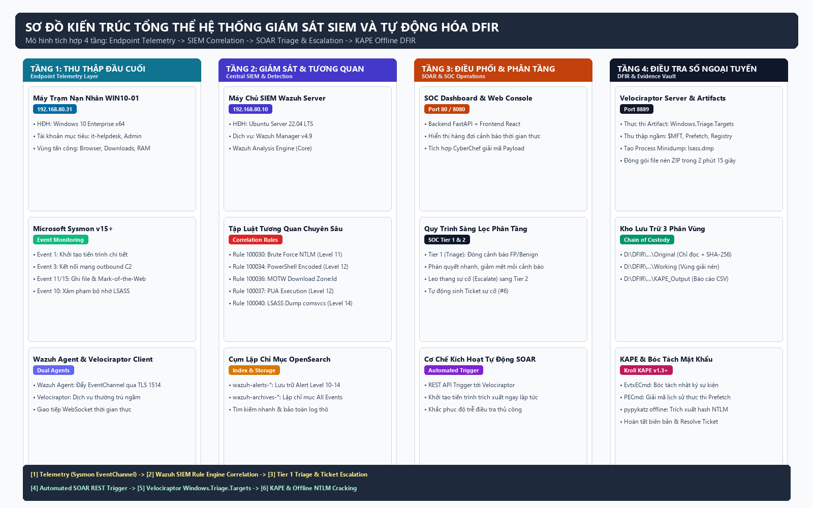
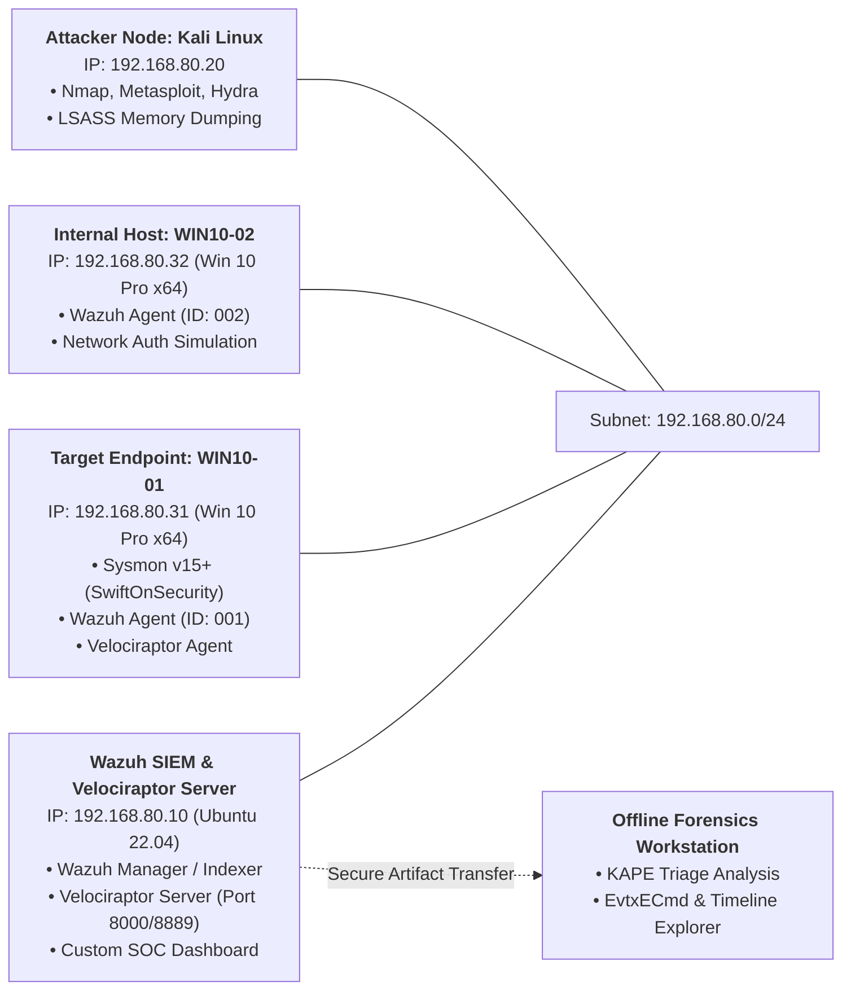
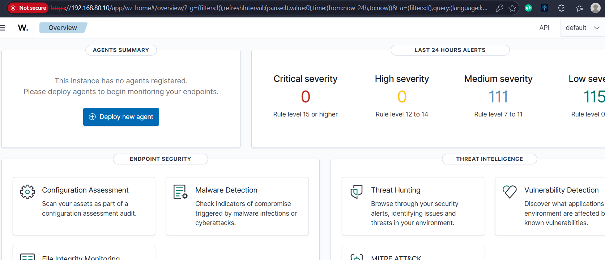
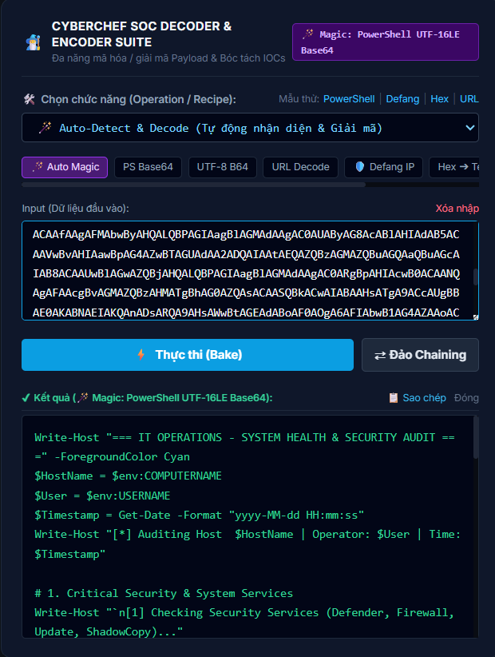
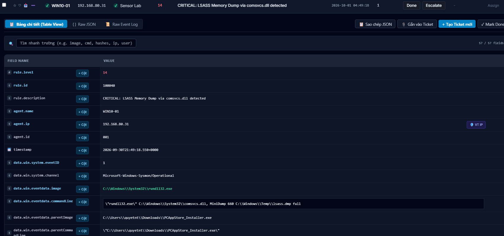
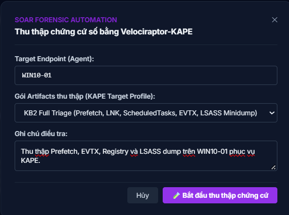
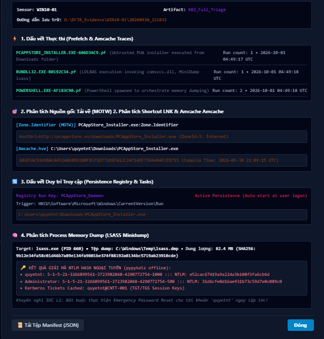
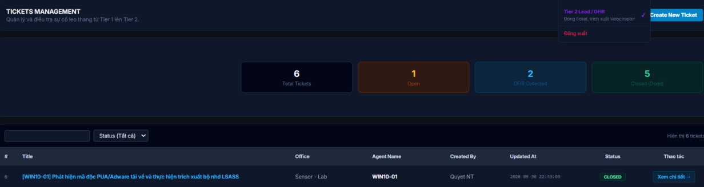

# 🛡️ Unified 2-Tier SOC & Automated DFIR Platform
### Integrating Centralized SIEM (Wazuh), Remote Live Forensics (Velociraptor), and Offline Triage (KAPE)

[](#)
[](#)
[](#)
[](#)

---

## 📌 Executive Summary & Problem Statement

Modern enterprise Security Operations Centers (SOCs) face an overwhelming volume of alerts, where **90%–95%** of detections are false positives or benign administrative anomalies. Escalating raw alerts directly to senior incident responders leads to severe **Alert Fatigue**, delayed Mean Time to Respond (MTTR), and fragmented investigation across multiple disparate tools.

This project designs and implements an end-to-end **Unified 2-Tier SOC & Digital Forensics and Incident Response (DFIR) Framework**:
* **Tier 1 (SOC L1 Analyst):** Continuous real-time detection, contextual validation, automated IoC enrichment, and early de-escalation of benign noise.
* **Tier 2 (DFIR Investigator):** Automated remote evidence acquisition via **Velociraptor VQL**, rapid offline artifact parsing using **KAPE**, maintaining strict forensic chain of custody (RFC 3227 & ISO/IEC 27037).

---

## 🏛️ System Architecture & Network Topology

The solution is architected as an integrated 4-layer model: **Endpoint Telemetry Layer $\rightarrow$ SIEM Processing Layer $\rightarrow$ L1 Triage & SOAR Orchestration $\rightarrow$ L2 DFIR Offline Analysis**:

<p align="center">
  
  <br>
  <em>Figure 1: Comprehensive 4-Tier Architecture connecting SIEM, SOAR, Velociraptor and KAPE Triage</em>
</p>



---

## ⚙️ Core Technical Capabilities & Implementation

### 1. Centralized Telemetry & Real-Time SIEM Monitoring
* **Telemetry Stack:** Combined `Sysmon v15+` with `Windows Security Event Logs` to detect Process Creation (Event 1), Network Connections (Event 3), Memory Tampering (Event 10), and File Creation (Event 11).
* **Unified Dashboard:** Real-time visibility into alert trends, top attacked endpoints, and MITRE ATT&CK tactic distribution.

<p align="center">
  
  <br>
  <em>Figure 2: Real-time Security Event Monitoring on Wazuh SIEM Dashboard</em>
</p>

---

### 2. Tier 1 Incident Triage & Inlined Script De-obfuscation
* **False Positive Reduction:** Investigated suspicious PowerShell executions triggered by automated administrative tasks.
* **Inline CyberChef Integration:** Built-in decoding workflows for Base64 / UTF-16LE obfuscated commands directly within the SOC Dashboard to verify execution context without external data leakage.

<p align="center">
  
  <br>
  <em>Figure 3: Inline CyberChef Tool resolving Base64 EncodedCommand during L1 Triage</em>
</p>

---

### 3. Multi-Stage Attack Detection: LSASS Dumping via LOLBAS
* **Detection:** SIEM triggers **Level 14 (CRITICAL)** upon detecting unauthorized memory access to `lsass.exe` using legitimate system utilities (LOLBAS).
* **Correlation:** Correlated parent-child execution telemetry across Sysmon Event 10 and Security Event 4688.

<p align="center">
  
  <br>
  <em>Figure 4: Critical Level 14 Alert flagged on SIEM upon memory access to LSASS</em>
</p>

---

### 4. Automated SOAR Evidence Acquisition (Velociraptor)
* **Ticket Escalation:** L1 Analyst bundles correlated alerts into **Incident Ticket #6** and escalates to Tier 2.
* **One-Click Forensic Acquisition:** Tier 2 triggers automated remote collection via Velociraptor API, gathering memory dumps and endpoint triage packages without disrupting production.

<p align="center">
  
  <br>
  <em>Figure 5: Incident Ticket #6 featuring One-Click Velociraptor SOAR Forensic Trigger</em>
</p>

---

### 5. Offline Deep Forensics (KAPE Triage) & Incident Resolution
* **Preserving Chain of Custody:** Extracted `$MFT`, `Prefetch`, `Amcache`, `Registry Hives`, and `Event Logs` hashed via SHA-256 for evidentiary integrity.
* **Forensic Findings:** Bounded execution timelines, confirmed credential compromise scope, and remediated compromised accounts before closing the ticket.

<p align="center">
  
  <br>
  <em>Figure 6: KAPE Offline Forensics Results revealing Prefetch, Registry, and NTLM artifacts</em>
</p>

<p align="center">
  
  <br>
  <em>Figure 7: Incident Ticket #6 successfully updated to RESOLVED following containment verification</em>
</p>

---

## 📂 Repository Structure

```
├── assets/                             # Architecture diagrams & UI screenshots
│   ├── architecture_4tier.png
│   ├── cyberchef_deobfuscation.png
│   ├── kape_offline_forensics.png
│   ├── lsass_dump_alert.png
│   ├── ticket_resolved.png
│   ├── velociraptor_soar_triage.png
│   └── wazuh_dashboard.png
├── docs/
│   └── Unified_SOC_DFIR_Technical_Report.pdf   # Complete 49-Page Technical Specification & Lab Report
├── playbooks/                                  # IR workflows & Triage check-sheets
├── rules/                                      # Custom Wazuh XML rules & Sysmon config
├── velociraptor/                               # Custom VQL artifact definitions
└── README.md                                   # System documentation
```

### 📄 Full Technical Report
For a complete, in-depth walkthrough of the system architecture, mathematical correlation models, and all 8 attack phases with forensic proof, see the full whitepaper:  
👉 [docs/Unified_SOC_DFIR_Technical_Report.pdf](docs/Unified_SOC_DFIR_Technical_Report.pdf) *(Starts directly at Table of Contents)*

---

## 🎓 Technical Credit
* **Author:** Nguyen Thanh Quyet ([@thzhquzt](https://github.com/thzhquzt))
* **Focus:** Defensive Cybersecurity, SOC Operations, Threat Detection & DFIR
