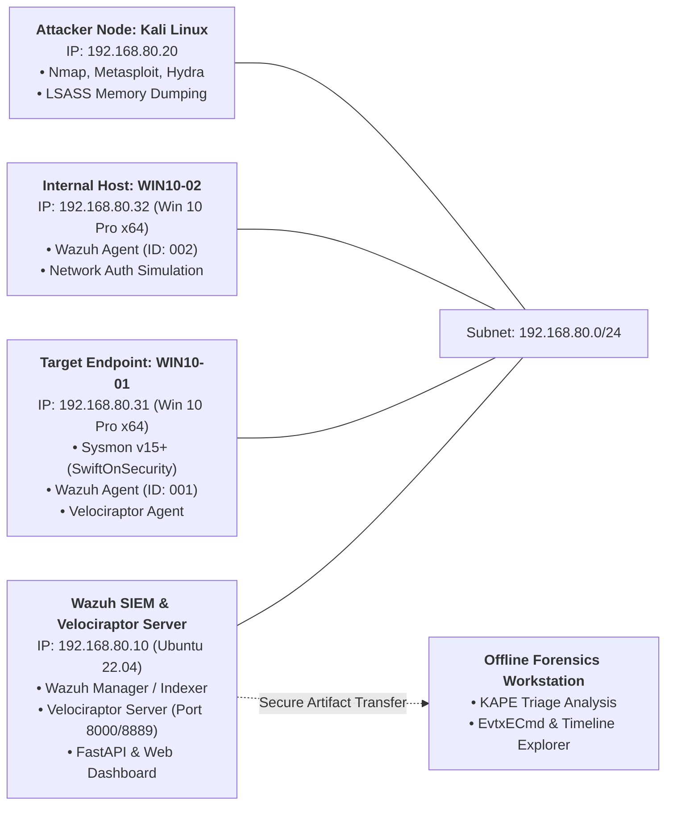

# 🛡️ Unified 2-Tier SOC & Automated DFIR Platform
### Integrating Centralized SIEM (Wazuh), Remote Live Forensics (Velociraptor), and Offline Triage (KAPE)

[](#)
[](#)
[](#)
[](#)

---

## 📌 Executive Summary & Problem Statement

Modern enterprise Security Operations Centers (SOCs) face an overwhelming volume of alerts, where **90%–95%** of detections are false positives or benign administrative anomalies. Escalating raw alerts directly to senior incident responders leads to severe **Alert Fatigue**, delayed Mean Time to Respond (MTTR), and fragmented investigation across multiple disparate tools.

This project designs and implements an end-to-end **Unified 2-Tier SOC & Digital Forensics and Incident Response (DFIR) Framework**:
* **Tier 1 (SOC L1 Analyst):** Continuous real-time detection, contextual validation, automated IoC enrichment, and early de-escalation of benign noise.
* **Tier 2 (DFIR Investigator):** Automated remote evidence acquisition via **Velociraptor VQL**, rapid offline artifact parsing using **KAPE**, maintaining strict forensic chain of custody (RFC 3227 & ISO/IEC 27037).

---

## 🏛️ System Architecture & Network Topology

The lab environment operates on a segregated subnet (`192.168.80.0/24`) designed for realistic adversary simulation, SIEM telemetry aggregation, and automated remote forensic triage:



---

## ⚙️ Core Technical Capabilities

### 1. Advanced Telemetry & SIEM Detection (Wazuh & OpenSearch)
* **Endpoint Telemetry:** Integrated `Microsoft Sysmon v15+` with `Windows Security Event Logs` to track Process Creation (Event 1), Network Connections (Event 3), Memory Tampering / Injection (Event 10), and File Creation (Event 11).
* **Detection & Correlation:** Authored custom Wazuh XML rules to map events directly to **MITRE ATT&CK** techniques (e.g., `T1003.001` LSASS Memory Dumping, `T1059.001` PowerShell Execution, `T1053` Scheduled Tasks).

### 2. Live Remote Forensics (Velociraptor & VQL)
* Deployed **Velociraptor** clients with secure TLS communication back to the centralized server.
* Utilized **Velociraptor Query Language (VQL)** to execute targeted remote forensic hunts:
  * Hunting active process injections and hidden modules in memory.
  * Auditing suspicious persistence mechanisms (Registry Run keys, startup folders, WMI subscriptions).
  * Remotely triggering comprehensive artifact collections without disrupting production users.

### 3. Automated Offline Triage Extraction (KAPE)
* Preserved strict **Chain of Custody** by extracting key Windows forensic artifacts using **KAPE (Kroll Artifact Parser and Extractor)**:
  * `$MFT` & `$LogFile` (NTFS File system tracking).
  * `Prefetch` & `Amcache.hve` (Evidence of execution).
  * `Shimcache` & `Registry Hives` (SYSTEM, SAM, SOFTWARE, NTUSER.dat).
  * `Windows Event Logs` (.evtx).
* Automated parsing using **EvtxECmd** into CSV format for rapid pivoting and forensic timeline reconstruction.

---

## 🔬 Attack Scenarios & Incident Response Playbooks

### Scenario 1: Credential Access via LSASS Memory Dump
1. **Adversary Execution:** Attacker utilizes Mimikatz on target `WIN10-01` to dump credentials from `lsass.exe`.
2. **SIEM Alert:** Wazuh catches Sysmon Event 10 (Process Access with `0x1010` / `0x143a` permissions targeting LSASS). Alert Level 12 triggers.
3. **L1 Triage:** Analyst investigates process hierarchy, verifies hash reputation, and escalates to Tier 2.
4. **DFIR Collection:** Velociraptor automatically initiates a memory hunt artifact and triggers KAPE triage package download (`KAPE_Triage.zip`).
5. **Root Cause Analysis:** Extracted Prefetch and Event Log analysis confirms execution timeline and credential compromise scope.

### Scenario 2: Remote Persistence & Scheduled Task Creation
1. **Adversary Action:** Malicious script establishes persistence via `schtasks.exe /create` executing obfuscated PowerShell.
2. **Detection:** Wazuh flags Rule 60106 / Sysmon Event 1 (`schtasks` executing with `-ExecutionPolicy Bypass`).
3. **Investigation:** Inlined Base64 payload de-obfuscated via CyberChef recipes; Velociraptor inspects Registry persistence keys.
4. **Remediation:** Endpoint isolated via Wazuh Active Response; persistence removed and firewall drop policies enforced.

---

## 📂 Repository Structure

```
├── docs/
│   └── Slide_CDCS_Presentation.pdf     # Academic Defense Presentation Slide
├── playbooks/                          # IR workflows & Triage check-sheets
├── rules/                              # Custom Wazuh XML rules & Sysmon config
├── velociraptor/                       # Custom VQL artifact definitions
└── README.md                           # System documentation
```

---

## 🎓 Academic Credit & Context
* **Institution:** Academy of Cryptography Techniques (Học viện Kỹ thuật Mật mã - KMA)
* **Author:** Nguyen Thanh Quyet ([@thzhquzt](https://github.com/thzhquzt))
* **Specialization:** Information Security / Defensive Cybersecurity & DFIR
